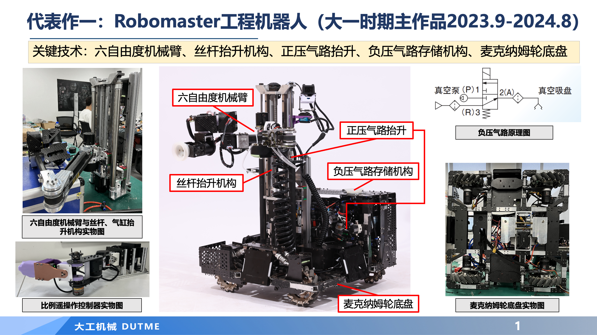
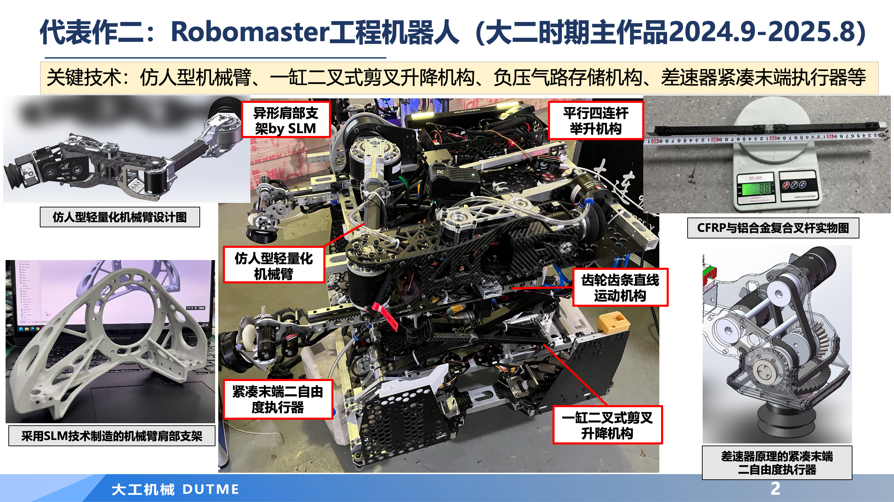
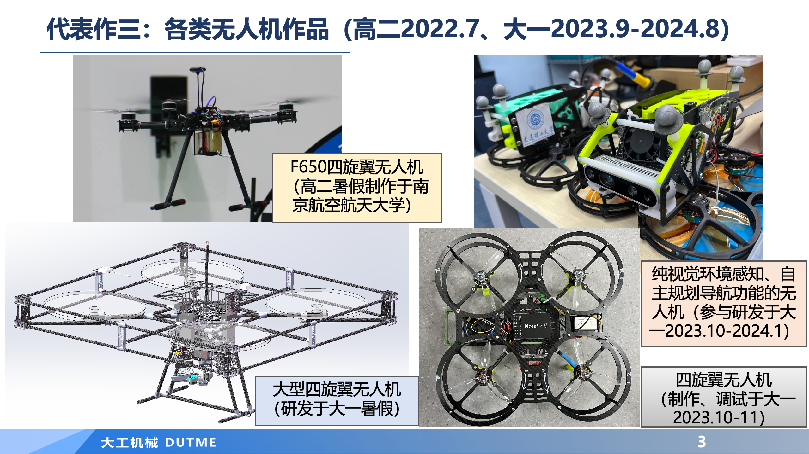
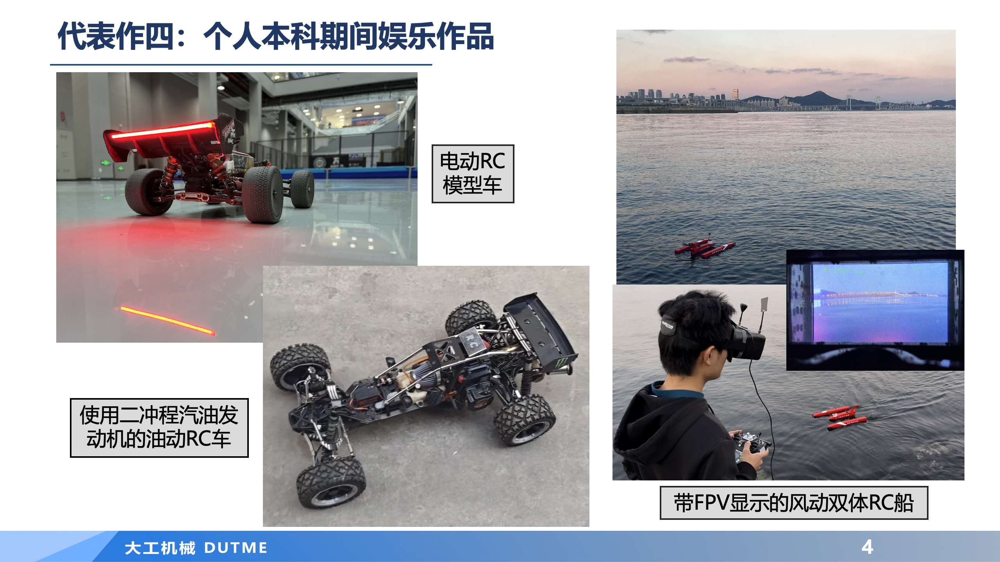
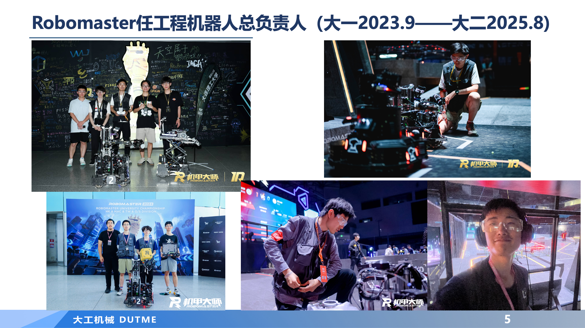

# 汤锶成代表作展示

[查看 PDF](Tang-Sicheng-Portfolio.pdf) · [下载 PDF](https://github.com/tangsicheng6/representative-works/raw/refs/heads/main/Tang-Sicheng-Portfolio.pdf) · [下载 PPT 原文件](https://github.com/tangsicheng6/representative-works/releases/download/v1.0.0/Tang-Sicheng-Portfolio.pptx)

以下为完整 5 页代表作，点击图片可放大查看。

## RoboMaster 工程机器人（2023—2024）

## RoboMaster 工程机器人（2024—2025）

## 无人机作品

## RC 模型车与 FPV 船

## RoboMaster 团队与比赛记录

